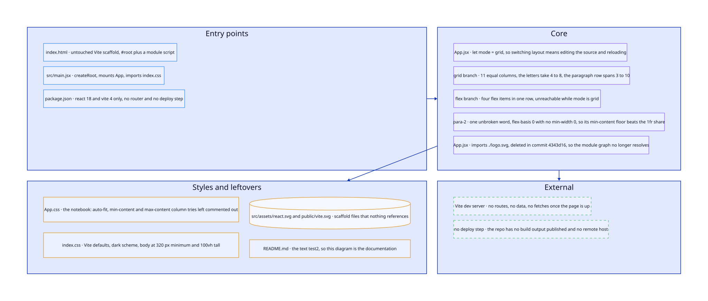

# react-qualia

A scratch pad for CSS grid and flex sizing: one React component, two hardcoded layout modes, and a paragraph of deliberately unbreakable text.

## Read it left to right

- **There is no app here.** `App.jsx` opens with `let mode = "grid"`. The complete flex version sits right below it and can never run — switching layouts means editing that line and reloading.
- **The 11-column grid is mostly spacer.** The five letters are pinned to columns 4–8 and the paragraph row spans 3–10, which is how the acronym lands centred without a wrapper element. `repeat(11, minmax(0,1fr))` also means the columns refuse to widen for their content.
- **`para-2` is the actual experiment.** Its three siblings share the row with `flex-basis: 0; flex-grow: 1`, so they should be equal thirds — but with no `min-width: 0`, a flex item cannot shrink below its min-content width, and that one unbroken word wins, pushing its panel past its share and spilling over the grid.
- **`App.css` is a notebook.** `repeat(auto-fit, …)`, `min-content` and `max-content` column attempts sit commented out beside the live rule; the layout history is in the file, not in the commits.
- **The module graph is broken.** `App.jsx` still imports `./logo.svg`, deleted when the repo moved to Vite (commit `4343d16`), so the file no longer exists and `vite build` cannot resolve it. `assets/react.svg` and `public/vite.svg` are untouched scaffold leftovers.

---

Diagram source: [`docs/system.d2`](docs/system.d2) · rendered by [`scripts/render-diagram.sh`](scripts/render-diagram.sh) into `docs/system.svg` (light + dark) and `docs/system.png` (dark, for gpm desktop).
